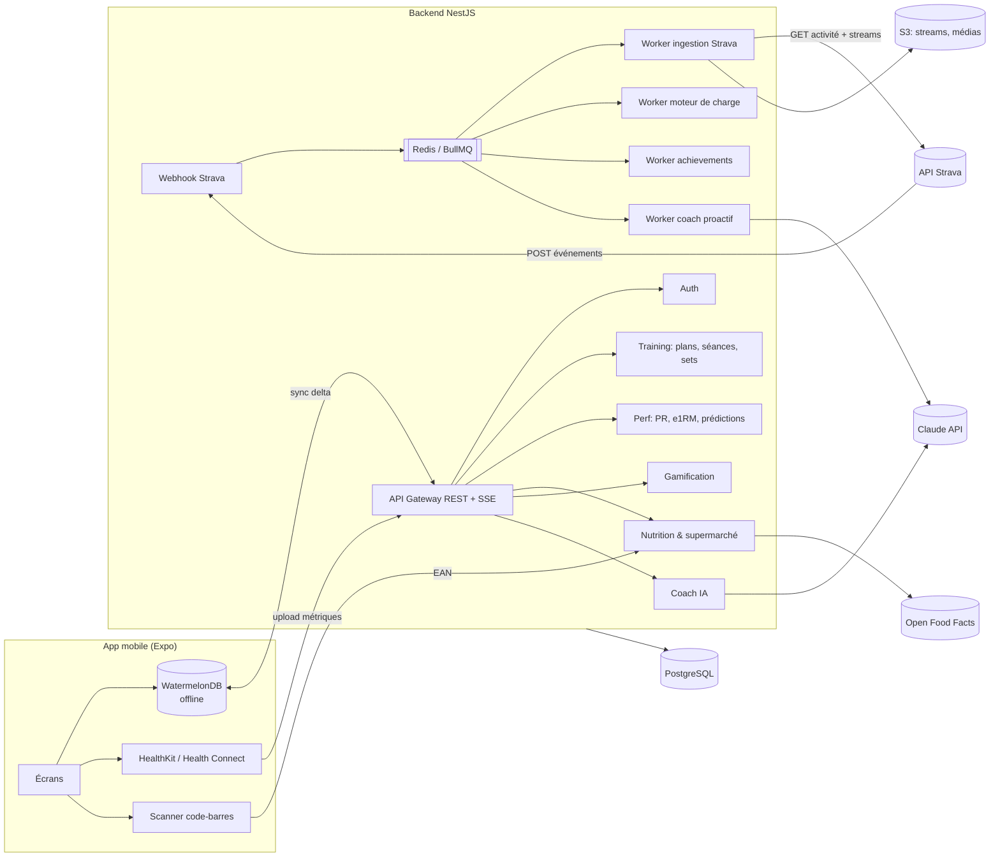
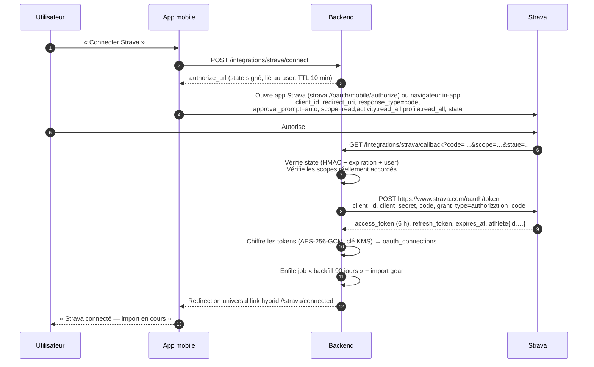
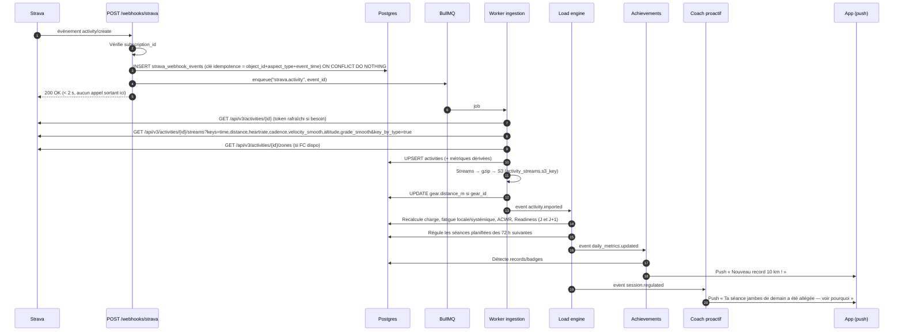

# 1. Architecture technique & flux de données

## 1.1 Choix de stack (recommandation)

| Couche | Choix | Justification |
|---|---|---|
| **App mobile** | **React Native + Expo (TypeScript)**, expo-router | Un seul code iOS/Android, réutilise les compétences web du prototype actuel, OTA updates (EAS Update), accès natif (caméra, HealthKit, notifications). |
| État / données app | TanStack Query (serveur) + **WatermelonDB** (SQLite, offline-first) | La saisie en salle doit marcher sans réseau ; synchro différée. |
| Graphiques / animations | Victory Native XL (Skia), Reanimated 3, Lottie | Graphiques fluides 60 fps, animations de célébration PR. |
| Scanner | react-native-vision-camera (code scanner EAN-13/UPC) | Lecture instantanée hors-ligne. |
| Santé | react-native-health (HealthKit), react-native-health-connect | HRV, FC repos, sommeil, poids → Readiness. |
| **Backend** | **NestJS (TypeScript), monolithe modulaire** | Un seul langage front/back, modules découplés (prêts à être extraits en services). |
| Base de données | **PostgreSQL 16** (+ extension TimescaleDB optionnelle pour `daily_metrics`) | Relationnel strict pour plans/séances/nutrition, JSONB pour les payloads bruts. |
| Files & jobs | **Redis + BullMQ** | Webhooks Strava asynchrones, recalculs, notifications, jobs nocturnes. |
| Stockage objets | S3 compatible (streams Strava gzip, vidéos tutos, photos repas) | Les streams seconde-par-seconde n'ont rien à faire en base. |
| Auth | Auth maison (JWT court + refresh rotatif) ou fournisseur (Clerk/Supabase Auth) ; **Sign in with Apple** obligatoire sur iOS si login social | |
| IA | **Claude API (Anthropic)**, modèle `claude-opus-5-5`, via `@anthropic-ai/sdk` | Voir [05-coach-ia.md](05-coach-ia.md). |
| Notifications | Expo Push (APNs/FCM) | Brief du matin, alertes chaussures/stock, PR. |
| Observabilité | OpenTelemetry → Grafana/Tempo, Sentry (app + API) | |
| Hébergement | **UE** (ex. AWS eu-west-3 Paris, Scaleway, OVHcloud) — idéalement hébergeur certifié **HDS** | Données de santé (RGPD art. 9). |

## 1.2 Vue d'ensemble



### Modules backend (bounded contexts)

| Module | Responsabilité | Événements émis |
|---|---|---|
| `identity` | Comptes, profils, consentements, appareils | `user.created` |
| `integrations` | Strava (OAuth, webhooks, backfill), Health, rate limiting | `activity.imported`, `activity.updated`, `activity.deleted`, `gear.updated` |
| `training` | Bibliothèque d'exercices, plans, séances planifiées/réalisées, sets | `workout.completed`, `plan.adjusted` |
| `load-engine` | Charge, fatigue systémique/locale, ACWR, Readiness, régulation | `daily_metrics.updated`, `session.regulated` |
| `performance` | PR, e1RM, Race Predictor, best efforts | `pr.achieved`, `prediction.updated` |
| `events` | Courses objectifs, tapering | `taper.started` |
| `gamification` | Achievement Engine, badges, statut | `badge.unlocked`, `tier.changed` |
| `nutrition` | Cibles du jour, suppléments, recettes, courses, scanner | `supplement.low_stock` |
| `coach` | Conversations IA, outils, propositions, mémoire | `proposal.created`, `proposal.accepted` |
| `notifications` | Push, in-app | — |

Communication interne : **bus d'événements en process** (EventEmitter NestJS) + **outbox pattern** (table `outbox_events`) pour les traitements asynchrones fiables via BullMQ.

## 1.3 Flux OAuth2 Strava

Principe : **le `client_secret` ne quitte jamais le backend**, et le `code` d'autorisation est échangé côté serveur.



**Points de vigilance**
- **Scopes** : `activity:read_all` est nécessaire pour les activités privées (sinon on rate des séances → charge sous-estimée). Si l'utilisateur décoche une case, l'API le détecte via le paramètre `scope` du callback et l'app explique la conséquence.
- **Refresh** : `access_token` expire après ~6 h. Avant chaque appel : si `expires_at < now + 5 min` → `POST /oauth/token` avec `grant_type=refresh_token`. **Toujours stocker le nouveau `refresh_token` renvoyé** (il peut changer). Verrou Redis par athlète pour éviter deux refresh concurrents.
- **Révocation** : bouton « Déconnecter » → `POST https://www.strava.com/oauth/deauthorize` + purge des tokens.
- **Capacité d'athlètes** : une nouvelle app Strava est limitée à 1 athlète (« single player mode ») tant qu'elle n'a pas passé la revue Strava → à planifier tôt (voir doc 07).
- **Branding** : bouton officiel « Connect with Strava » et mention « Powered by Strava » obligatoires.

## 1.4 Webhooks Strava (synchronisation temps réel)

Strava n'autorise **qu'un abonnement push par application**, qui couvre tous les athlètes ayant autorisé l'app.

### Création de l'abonnement (une fois, script d'admin)
```
POST https://www.strava.com/api/v3/push_subscriptions
  client_id, client_secret,
  callback_url=https://api.hybrid.app/webhooks/strava,
  verify_token=<secret aléatoire>
```
Strava appelle alors `GET /webhooks/strava?hub.mode=subscribe&hub.challenge=XYZ&hub.verify_token=…` ; l'API vérifie le `verify_token` et répond **en moins de 2 s** : `{"hub.challenge":"XYZ"}`.

### Réception des événements
Payload type :
```json
{
  "object_type": "activity",       // ou "athlete"
  "object_id": 1360128428,
  "aspect_type": "create",         // create | update | delete
  "owner_id": 134815,              // athlete id Strava
  "subscription_id": 120475,
  "event_time": 1516126040,
  "updates": {}                    // ex. {"title":"…"} ou {"authorized":"false"}
}
```



**Gestion des cas**
| Événement | Action |
|---|---|
| `activity` / `create` | Import complet (ci-dessus). |
| `activity` / `update` | Re-fetch de l'activité (titre, type, `private`, gear modifiés) ; si le **type** change (ex. Run → Ride), recalcul de la charge. |
| `activity` / `delete` | Suppression logique + recalcul de la charge + retrait des PR dérivés. |
| `athlete` / `update` avec `updates.authorized = "false"` | Désautorisation : suppression des tokens, des activités et streams issus de Strava (conformité accord API Strava), notification in-app. |

**Robustesse**
- Strava ré-essaie l'envoi si pas de 200 → idempotence obligatoire.
- **Rate limiting** : limites par application (fenêtre 15 min + quota journalier, lisibles dans les en-têtes `X-RateLimit-Limit` / `X-RateLimit-Usage`, et quotas « read » séparés). Implémenter un token-bucket Redis global ; priorités BullMQ : *webhook temps réel* > *backfill*. Sur 429 → backoff jusqu'à la fenêtre suivante.
- **Backfill** à la connexion : `GET /athlete/activities?after=<now-90j>&per_page=200` paginé, en file basse priorité (les streams détaillés seulement pour les 28 derniers jours, le reste en résumé).
- **Réconciliation nocturne** : job qui liste les activités des 48 dernières heures pour rattraper un webhook perdu.

## 1.5 Autres sources de données

| Source | Données | Usage |
|---|---|---|
| Apple HealthKit / Google Health Connect | HRV (SDNN/RMSSD), FC repos, sommeil, poids, pas, entraînements non-Strava | Readiness, BMR, NEAT |
| Saisie manuelle | Séances muscu, sports co. (foot), HYROX, ressentis (Hooper), RPE de séance | Charge, régulation |
| Open Food Facts API | `GET https://world.openfoodfacts.org/api/v2/product/{ean}.json` | Scanner (licence ODbL → attribution) |
| (v2) Garmin Health API / Coros / Polar | Activités + HRV natifs | Alternative à Strava |

## 1.6 Synchronisation hors-ligne (saisie muscu)

- Chaque entité modifiable sur mobile possède `id` UUIDv7 généré côté client, `updated_at`, `deleted_at`, `client_rev`.
- Protocole **pull/push delta** (compatible WatermelonDB) : `GET /sync/pull?last_pulled_at=…` et `POST /sync/push`.
- Conflits : *last-write-wins* par champ pour les sets ; pour une séance terminée sur deux appareils → fusion des sets par `id`.
- Le calcul de charge est **toujours refait côté serveur** à la réception (`workout.completed`), le mobile n'affiche qu'une estimation provisoire.

## 1.7 API (extraits)

| Méthode | Route | Description |
|---|---|---|
| GET | `/me/today` | Agrégat Dashboard : séance du jour (régulée), Readiness, macros, alertes |
| GET | `/plans/current?week=…` | Semaine de plan avec séances et justifications d'ajustement |
| POST | `/workouts/{id}/sets` | Ajout d'une série (aussi via sync) |
| POST | `/workouts/{id}/complete` | Clôture + sRPE de séance |
| GET | `/performance/prs`, `/performance/e1rm?exercise=…` | Records & historiques |
| GET | `/performance/predictions` | Prédictions 5k/10k/semi/marathon + intervalles |
| GET/POST | `/races` | Échéances |
| POST | `/wellness` | Check-in matinal (sommeil, stress, courbatures, fatigue, humeur) |
| GET | `/nutrition/today` | Cibles du jour + suivi supplémentation |
| POST | `/nutrition/scan` | `{ean, context}` → score d'adéquation |
| POST | `/coach/conversations/{id}/messages` | Message au coach (réponse en **SSE streaming**) |
| POST | `/coach/proposals/{id}/accept` \| `/reject` | Valider un changement de programme |

## 1.8 Sécurité & vie privée

- TLS 1.3 partout, HSTS, certificate pinning optionnel sur mobile.
- Tokens Strava et données de santé sensibles **chiffrés au niveau applicatif** (AES-256-GCM, clés en KMS, rotation).
- JWT d'accès 15 min + refresh token rotatif stocké dans Keychain / Keystore (expo-secure-store).
- Row-level security PostgreSQL (`user_id = current_setting('app.user_id')`) en défense en profondeur.
- RGPD : consentement explicite et granulaire (santé, Strava, IA), registre de traitement, export JSON complet, suppression de compte (purge sous 30 j, y compris S3 et sauvegardes au cycle suivant), DPA avec sous-traitants (hébergeur, Anthropic, Expo).
- Données envoyées à l'IA : minimisées (pas d'email/nom, ID pseudonyme), voir [05-coach-ia.md](05-coach-ia.md).
