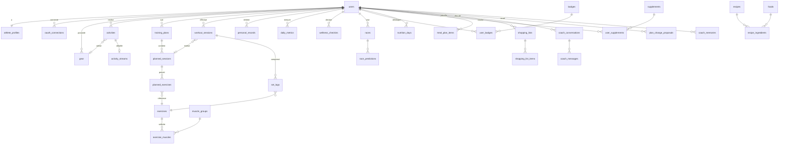

# 2. Modèle de données (PostgreSQL 16)

Conventions : clés primaires `uuid` (UUIDv7, triables dans le temps), horodatages `timestamptz` en UTC, unités **SI** stockées (mètres, secondes, kg, kcal), conversion à l'affichage. Toutes les tables « utilisateur » portent `user_id` + RLS. Suppression logique (`deleted_at`) pour les entités synchronisées hors-ligne.

## 2.1 Diagramme entité-relation (vue d'ensemble)



## 2.2 DDL

### Identité & intégrations

```sql
CREATE EXTENSION IF NOT EXISTS citext;

CREATE TYPE sex AS ENUM ('male','female','other');
CREATE TYPE sport_type AS ENUM ('run','trail_run','treadmill','strength','hyrox','football','bike','swim','walk','hike','mobility','other');

CREATE TABLE users (
  id              uuid PRIMARY KEY,
  email           citext UNIQUE NOT NULL,
  password_hash   text,                         -- null si SSO
  locale          text NOT NULL DEFAULT 'fr-FR',
  timezone        text NOT NULL DEFAULT 'Europe/Paris',
  unit_system     text NOT NULL DEFAULT 'metric',
  created_at      timestamptz NOT NULL DEFAULT now(),
  deleted_at      timestamptz
);

CREATE TABLE consents (
  user_id      uuid REFERENCES users(id) ON DELETE CASCADE,
  kind         text NOT NULL,          -- 'health_data','strava','ai_coach','marketing'
  granted      boolean NOT NULL,
  version      text NOT NULL,          -- version du texte accepté
  granted_at   timestamptz NOT NULL DEFAULT now(),
  PRIMARY KEY (user_id, kind, version)
);

CREATE TABLE athlete_profiles (
  user_id              uuid PRIMARY KEY REFERENCES users(id) ON DELETE CASCADE,
  birth_date           date,
  sex                  sex,
  height_cm            numeric(5,1),
  weight_kg            numeric(5,2),          -- dernier poids connu (historique dans body_metrics)
  hr_max               smallint,              -- mesurée ou estimée
  hr_rest              smallint,
  lthr                 smallint,              -- FC au seuil lactique
  vma_kmh              numeric(4,1),
  experience_run       text,                  -- 'beginner'|'intermediate'|'advanced'
  experience_lift      text,
  primary_goal         text,                  -- 'hybrid_balanced'|'run_focus'|'strength_focus'|'hyrox'
  lift_goal            text,                  -- 'hypertrophy'|'strength'|'maintenance'
  weekly_availability  jsonb NOT NULL,        -- {"mon":["morning"],"wed":["evening"],...}
  equipment            text[] NOT NULL DEFAULT '{}', -- 'barbell','dumbbells','machines','treadmill'...
  injuries             jsonb NOT NULL DEFAULT '[]',
  diet_preferences     jsonb NOT NULL DEFAULT '{}', -- végétarien, allergies, budget
  updated_at           timestamptz NOT NULL DEFAULT now()
);

CREATE TABLE body_metrics (
  id          uuid PRIMARY KEY,
  user_id     uuid NOT NULL REFERENCES users(id) ON DELETE CASCADE,
  measured_at timestamptz NOT NULL,
  weight_kg   numeric(5,2),
  body_fat_pct numeric(4,1),
  hrv_rmssd_ms numeric(5,1),
  hr_rest     smallint,
  sleep_minutes smallint,
  source      text NOT NULL            -- 'manual','healthkit','health_connect'
);
CREATE INDEX ON body_metrics (user_id, measured_at DESC);

CREATE TABLE oauth_connections (
  id                uuid PRIMARY KEY,
  user_id           uuid NOT NULL REFERENCES users(id) ON DELETE CASCADE,
  provider          text NOT NULL,              -- 'strava'
  provider_user_id  text NOT NULL,              -- athlete id Strava
  access_token_enc  bytea NOT NULL,             -- chiffré AES-GCM
  refresh_token_enc bytea NOT NULL,
  expires_at        timestamptz NOT NULL,
  scopes            text[] NOT NULL,
  status            text NOT NULL DEFAULT 'active', -- 'active','revoked','error'
  last_sync_at      timestamptz,
  created_at        timestamptz NOT NULL DEFAULT now(),
  UNIQUE (provider, provider_user_id),
  UNIQUE (user_id, provider)
);

CREATE TABLE strava_webhook_events (
  id            bigserial PRIMARY KEY,
  object_type   text NOT NULL,
  object_id     bigint NOT NULL,
  aspect_type   text NOT NULL,
  owner_id      bigint NOT NULL,
  event_time    bigint NOT NULL,
  updates       jsonb,
  received_at   timestamptz NOT NULL DEFAULT now(),
  processed_at  timestamptz,
  error         text,
  UNIQUE (object_id, aspect_type, event_time)    -- idempotence
);
```

### Matériel & activités (course et autres sports)

```sql
CREATE TABLE gear (
  id               uuid PRIMARY KEY,
  user_id          uuid NOT NULL REFERENCES users(id) ON DELETE CASCADE,
  external_id      text,                        -- ex. 'g12345' Strava
  kind             text NOT NULL DEFAULT 'shoe',
  brand            text, model text, nickname text,
  category         text,                        -- 'daily','tempo','racing_carbon','trail'
  distance_m       integer NOT NULL DEFAULT 0,  -- cumul (Strava + manuel)
  initial_distance_m integer NOT NULL DEFAULT 0,
  retire_at_m      integer NOT NULL DEFAULT 700000, -- seuil d'usure configurable
  retired          boolean NOT NULL DEFAULT false,
  purchased_on     date,
  UNIQUE (user_id, external_id)
);

CREATE TABLE activities (
  id                 uuid PRIMARY KEY,
  user_id            uuid NOT NULL REFERENCES users(id) ON DELETE CASCADE,
  source             text NOT NULL,             -- 'strava','manual','healthkit'
  external_id        bigint,
  sport              sport_type NOT NULL,
  name               text,
  start_at           timestamptz NOT NULL,
  elapsed_s          integer NOT NULL,
  moving_s           integer,
  distance_m         numeric(9,1),
  elev_gain_m        numeric(7,1),
  elev_loss_m        numeric(7,1),
  avg_speed_ms       numeric(5,3),
  max_speed_ms       numeric(5,3),
  avg_hr             smallint,
  max_hr             smallint,
  avg_cadence_spm    smallint,                  -- pas/min (cadence Strava ×2 en course)
  avg_power_w        smallint,
  calories_kcal      integer,
  gear_id            uuid REFERENCES gear(id),
  is_private         boolean,
  rpe                smallint CHECK (rpe BETWEEN 1 AND 10),  -- ressenti saisi dans l'app
  -- métriques dérivées (load engine)
  hr_zone_seconds    integer[5],                -- temps en Z1..Z5
  trimp              numeric(7,1),
  load_au            numeric(7,1),              -- charge unifiée (UA)
  leg_impact_score   numeric(6,1),              -- contribution fatigue jambes
  decoupling_pct     numeric(5,2),              -- dérive cardiaque (Pa:HR)
  gap_avg_speed_ms   numeric(5,3),              -- vitesse ajustée à la pente
  workout_type       text,                      -- 'easy','long','tempo','intervals','race'
  planned_session_id uuid,                      -- rapprochement avec le plan
  raw                jsonb,                     -- payload source
  created_at         timestamptz NOT NULL DEFAULT now(),
  deleted_at         timestamptz,
  UNIQUE (source, external_id)
);
CREATE INDEX ON activities (user_id, start_at DESC) WHERE deleted_at IS NULL;

CREATE TABLE activity_streams (
  activity_id  uuid PRIMARY KEY REFERENCES activities(id) ON DELETE CASCADE,
  s3_key       text NOT NULL,                   -- JSON gzip {time:[],heartrate:[],...}
  keys         text[] NOT NULL,
  points       integer NOT NULL
);

CREATE TABLE best_efforts (                     -- meilleurs efforts glissants extraits des streams
  id           uuid PRIMARY KEY,
  user_id      uuid NOT NULL REFERENCES users(id) ON DELETE CASCADE,
  activity_id  uuid NOT NULL REFERENCES activities(id) ON DELETE CASCADE,
  distance_m   integer NOT NULL,                -- 400,1000,1609,5000,10000,21097,42195
  time_s       numeric(8,1) NOT NULL,
  achieved_at  timestamptz NOT NULL
);
CREATE INDEX ON best_efforts (user_id, distance_m, time_s);
```

### Bibliothèque d'exercices & programmes

```sql
CREATE TABLE muscle_groups (
  id    smallserial PRIMARY KEY,
  code  text UNIQUE NOT NULL,     -- 'quads','hamstrings','glutes','calves','chest','back','shoulders','biceps','triceps','core'
  is_lower_body boolean NOT NULL
);

CREATE TABLE exercises (
  id              uuid PRIMARY KEY,
  slug            text UNIQUE NOT NULL,          -- 'back-squat'
  name_fr         text NOT NULL,
  pattern         text NOT NULL,                 -- 'squat','hinge','lunge','push_h','push_v','pull_h','pull_v','carry','core','plyo'
  equipment       text[] NOT NULL,
  is_compound     boolean NOT NULL,
  unilateral      boolean NOT NULL DEFAULT false,
  axial_load      smallint NOT NULL DEFAULT 0,   -- 0-3, charge sur la colonne
  eccentric_leg_stress smallint NOT NULL DEFAULT 0, -- 0-3, impact sur la course
  video_url       text, thumbnail_url text,
  cues_fr         text[],                        -- consignes techniques
  common_errors_fr text[],
  substitutions   uuid[]                         -- alternatives (matériel/douleur)
);

CREATE TABLE exercise_muscles (
  exercise_id     uuid REFERENCES exercises(id) ON DELETE CASCADE,
  muscle_group_id smallint REFERENCES muscle_groups(id),
  role            text NOT NULL,                 -- 'primary','secondary'
  weight          numeric(3,2) NOT NULL,         -- part de la fatigue (somme = 1)
  PRIMARY KEY (exercise_id, muscle_group_id)
);

CREATE TABLE program_templates (               -- modèles éditoriaux (coachs)
  id            uuid PRIMARY KEY,
  name          text NOT NULL,                 -- 'Hybride Semi 12 sem — Force'
  run_goal      text,                          -- '5k','10k','half','marathon','none'
  lift_goal     text,
  weeks         smallint NOT NULL,
  sessions_per_week smallint NOT NULL,
  level         text NOT NULL,
  structure     jsonb NOT NULL                 -- squelette de mésocycles/semaines
);

CREATE TABLE training_plans (
  id              uuid PRIMARY KEY,
  user_id         uuid NOT NULL REFERENCES users(id) ON DELETE CASCADE,
  template_id     uuid REFERENCES program_templates(id),
  race_id         uuid,                        -- FK ajoutée après races
  name            text NOT NULL,
  start_date      date NOT NULL,
  end_date        date NOT NULL,
  status          text NOT NULL DEFAULT 'active', -- 'active','paused','completed','archived'
  generator_version text NOT NULL,             -- version de l'algo de génération
  created_at      timestamptz NOT NULL DEFAULT now()
);

CREATE TABLE plan_phases (
  id        uuid PRIMARY KEY,
  plan_id   uuid NOT NULL REFERENCES training_plans(id) ON DELETE CASCADE,
  kind      text NOT NULL,                     -- 'base','build','peak','taper','race','recovery'
  start_date date NOT NULL, end_date date NOT NULL,
  focus     text
);

CREATE TABLE planned_sessions (
  id               uuid PRIMARY KEY,
  plan_id          uuid NOT NULL REFERENCES training_plans(id) ON DELETE CASCADE,
  user_id          uuid NOT NULL REFERENCES users(id) ON DELETE CASCADE,
  scheduled_date   date NOT NULL,
  slot             text,                       -- 'am','pm'
  sport            sport_type NOT NULL,
  title            text NOT NULL,              -- 'Seuil 3×10 min', 'Force bas du corps'
  run_workout_type text,                       -- 'easy','long','tempo','intervals','race_pace','recovery'
  run_structure    jsonb,                      -- étapes: [{type:'warmup',dur_s:900,zone:'Z1-Z2'},{type:'rep',count:3,dur_s:600,pace_target:'4:15/km'}...]
  target_load_au   numeric(7,1),
  target_leg_impact numeric(6,1),
  priority         smallint NOT NULL DEFAULT 2, -- 1 = clé (non négociable), 3 = optionnelle
  status           text NOT NULL DEFAULT 'planned', -- 'planned','regulated','done','skipped','moved'
  original         jsonb,                      -- version avant régulation
  regulation_reason text,                      -- explication lisible
  regulated_by     text,                       -- 'engine','coach_proposal','user'
  updated_at       timestamptz NOT NULL DEFAULT now()
);
CREATE INDEX ON planned_sessions (user_id, scheduled_date);

CREATE TABLE planned_exercises (
  id                uuid PRIMARY KEY,
  planned_session_id uuid NOT NULL REFERENCES planned_sessions(id) ON DELETE CASCADE,
  exercise_id       uuid NOT NULL REFERENCES exercises(id),
  order_idx         smallint NOT NULL,
  superset_group    smallint,
  sets              smallint NOT NULL,
  reps_min          smallint NOT NULL, reps_max smallint NOT NULL,
  target_rpe        numeric(3,1),             -- ex. 8.0
  pct_1rm           numeric(4,1),             -- ex. 75.0 (optionnel)
  suggested_load_kg numeric(6,2),             -- calculé depuis e1RM
  tempo             text,                     -- '3-1-1-0' (excentrique-pause-concentrique-pause)
  rest_s            smallint,
  notes             text
);
```

### Séances réalisées & performances

```sql
CREATE TABLE workout_sessions (
  id                 uuid PRIMARY KEY,
  user_id            uuid NOT NULL REFERENCES users(id) ON DELETE CASCADE,
  planned_session_id uuid REFERENCES planned_sessions(id),
  activity_id        uuid REFERENCES activities(id),  -- si Strava a aussi enregistré la séance
  started_at         timestamptz NOT NULL,
  ended_at           timestamptz,
  session_rpe        smallint CHECK (session_rpe BETWEEN 1 AND 10), -- Foster CR-10
  tonnage_kg         numeric(9,1),            -- Σ charge × reps
  load_au            numeric(7,1),
  leg_impact_score   numeric(6,1),
  notes              text,
  updated_at         timestamptz NOT NULL DEFAULT now(),
  deleted_at         timestamptz
);
CREATE INDEX ON workout_sessions (user_id, started_at DESC);

CREATE TABLE set_logs (
  id            uuid PRIMARY KEY,               -- généré côté mobile
  workout_id    uuid NOT NULL REFERENCES workout_sessions(id) ON DELETE CASCADE,
  exercise_id   uuid NOT NULL REFERENCES exercises(id),
  set_idx       smallint NOT NULL,
  set_type      text NOT NULL DEFAULT 'working', -- 'warmup','working','drop','amrap','failure'
  load_kg       numeric(6,2) NOT NULL,           -- PDC: 0 + bodyweight flag
  reps          smallint NOT NULL,
  rpe           numeric(3,1),
  rir           smallint,
  tempo         text,
  e1rm_kg       numeric(6,2),                    -- calculé
  is_pr         boolean NOT NULL DEFAULT false,
  logged_at     timestamptz NOT NULL,
  updated_at    timestamptz NOT NULL DEFAULT now(),
  deleted_at    timestamptz
);
CREATE INDEX ON set_logs (exercise_id, logged_at);

CREATE TABLE personal_records (
  id           uuid PRIMARY KEY,
  user_id      uuid NOT NULL REFERENCES users(id) ON DELETE CASCADE,
  kind         text NOT NULL,       -- 'lift_e1rm','lift_rep_max','lift_volume','run_distance_time','run_longest','run_elev'
  exercise_id  uuid REFERENCES exercises(id),
  reps         smallint,            -- pour rep-max (ex. 5RM)
  distance_m   integer,             -- pour course
  value        numeric(10,2) NOT NULL,   -- kg, secondes, mètres
  previous_value numeric(10,2),
  source_set_id uuid, source_activity_id uuid,
  achieved_at  timestamptz NOT NULL
);
CREATE INDEX ON personal_records (user_id, kind, exercise_id, distance_m, achieved_at DESC);

CREATE TABLE e1rm_history (               -- meilleur e1RM par exercice et par jour (graphes)
  user_id     uuid NOT NULL REFERENCES users(id) ON DELETE CASCADE,
  exercise_id uuid NOT NULL REFERENCES exercises(id),
  day         date NOT NULL,
  e1rm_kg     numeric(6,2) NOT NULL,
  PRIMARY KEY (user_id, exercise_id, day)
);
```

### Charge, fatigue, récupération, échéances

```sql
CREATE TABLE daily_metrics (               -- 1 ligne / user / jour, recalculée par le load engine
  user_id            uuid NOT NULL REFERENCES users(id) ON DELETE CASCADE,
  day                date NOT NULL,
  load_run_au        numeric(7,1) NOT NULL DEFAULT 0,
  load_lift_au       numeric(7,1) NOT NULL DEFAULT 0,
  load_other_au      numeric(7,1) NOT NULL DEFAULT 0,
  load_total_au      numeric(7,1) NOT NULL DEFAULT 0,
  atl                numeric(7,2),           -- fatigue aiguë (EWMA 7 j)
  ctl                numeric(7,2),           -- forme chronique (EWMA 42 j)
  tsb                numeric(7,2),           -- CTL − ATL
  acwr               numeric(4,2),           -- EWMA 7 j / EWMA 28 j
  monotony           numeric(4,2),
  fatigue_systemic   numeric(5,1),           -- 0-100
  fatigue_local      jsonb,                  -- {"quads":62,"hamstrings":48,"calves":55,...}
  leg_fatigue        numeric(5,1),           -- 0-100 agrégé bas du corps
  readiness          smallint,               -- 0-100
  readiness_components jsonb,                -- détail pour l'explicabilité
  engine_version     text NOT NULL,
  computed_at        timestamptz NOT NULL DEFAULT now(),
  PRIMARY KEY (user_id, day)
);

CREATE TABLE wellness_checkins (           -- questionnaire Hooper adapté (1 = excellent, 7 = très mauvais)
  id          uuid PRIMARY KEY,
  user_id     uuid NOT NULL REFERENCES users(id) ON DELETE CASCADE,
  day         date NOT NULL,
  sleep_quality smallint, fatigue smallint, stress smallint, soreness smallint, mood smallint,
  sleep_hours numeric(3,1),
  pain_locations text[],                   -- signalement de douleur → garde-fou
  note        text,
  UNIQUE (user_id, day)
);

CREATE TABLE races (
  id             uuid PRIMARY KEY,
  user_id        uuid NOT NULL REFERENCES users(id) ON DELETE CASCADE,
  name           text NOT NULL,
  race_date      date NOT NULL,
  distance_m     integer NOT NULL,
  elev_gain_m    integer,
  kind           text NOT NULL DEFAULT 'road', -- 'road','trail','hyrox','other'
  priority       char(1) NOT NULL DEFAULT 'A', -- A = objectif, B = préparation, C = entraînement
  goal_time_s    integer,
  result_time_s  integer,
  result_activity_id uuid REFERENCES activities(id),
  taper_start    date,                         -- calculé
  status         text NOT NULL DEFAULT 'upcoming'
);
ALTER TABLE training_plans ADD FOREIGN KEY (race_id) REFERENCES races(id);

CREATE TABLE race_predictions (
  id             uuid PRIMARY KEY,
  user_id        uuid NOT NULL REFERENCES users(id) ON DELETE CASCADE,
  race_id        uuid REFERENCES races(id),
  distance_m     integer NOT NULL,
  predicted_s    integer NOT NULL,
  low_s          integer NOT NULL, high_s integer NOT NULL,   -- intervalle ~80 %
  confidence     numeric(3,2) NOT NULL,
  factors        jsonb NOT NULL,             -- contributions (VDOT, volume, force, poids...)
  model_version  text NOT NULL,
  computed_at    timestamptz NOT NULL DEFAULT now()
);
```

### Gamification

```sql
CREATE TABLE badges (
  id          uuid PRIMARY KEY,
  code        text UNIQUE NOT NULL,          -- 'STR_BW_SQUAT_1_5'
  pillar      text NOT NULL,                 -- 'strength','endurance','hybrid','consistency'
  tier        smallint NOT NULL,             -- 1 bronze … 4 diamant
  name_fr     text NOT NULL,
  description_fr text NOT NULL,
  rule        jsonb NOT NULL,                -- DSL évalué par l'Achievement Engine
  icon        text NOT NULL,
  secret      boolean NOT NULL DEFAULT false
);

CREATE TABLE user_badges (
  user_id     uuid REFERENCES users(id) ON DELETE CASCADE,
  badge_id    uuid REFERENCES badges(id),
  unlocked_at timestamptz NOT NULL DEFAULT now(),
  context     jsonb,                         -- {activity_id:…, value:…}
  seen        boolean NOT NULL DEFAULT false,
  PRIMARY KEY (user_id, badge_id)
);

CREATE TABLE hybrid_status_history (
  user_id        uuid REFERENCES users(id) ON DELETE CASCADE,
  computed_on    date NOT NULL,
  strength_index numeric(5,1) NOT NULL,      -- 0-100
  endurance_index numeric(5,1) NOT NULL,     -- 0-100
  consistency_index numeric(5,1) NOT NULL,   -- 0-100
  hybrid_score   numeric(5,1) NOT NULL,
  tier           text NOT NULL,              -- 'bronze','silver','gold','platinum','diamond'
  PRIMARY KEY (user_id, computed_on)
);

CREATE TABLE streaks (
  user_id     uuid PRIMARY KEY REFERENCES users(id) ON DELETE CASCADE,
  current_weeks smallint NOT NULL DEFAULT 0,  -- semaines consécutives ≥ objectif de séances
  best_weeks  smallint NOT NULL DEFAULT 0,
  freeze_tokens smallint NOT NULL DEFAULT 1   -- joker (maladie, vacances)
);
```

### Nutrition, suppléments, supermarché

```sql
CREATE TABLE nutrition_days (               -- cibles calculées + consommé
  user_id        uuid REFERENCES users(id) ON DELETE CASCADE,
  day            date NOT NULL,
  day_type       text NOT NULL,              -- 'rest','light','moderate','hard','long_run','race','carb_load'
  target_kcal    integer NOT NULL,
  target_protein_g integer NOT NULL, target_carbs_g integer NOT NULL, target_fat_g integer NOT NULL,
  target_water_ml integer,
  consumed       jsonb NOT NULL DEFAULT '{}', -- {kcal, protein_g, carbs_g, fat_g}
  computation    jsonb NOT NULL,             -- BMR, NEAT, EEE, facteurs → explicabilité
  PRIMARY KEY (user_id, day)
);

CREATE TABLE supplements (
  id          uuid PRIMARY KEY,
  code        text UNIQUE NOT NULL,          -- 'whey','creatine_mono','caffeine','electrolytes'
  name_fr     text NOT NULL,
  default_unit text NOT NULL                 -- 'g'
);

CREATE TABLE user_supplements (
  id              uuid PRIMARY KEY,
  user_id         uuid NOT NULL REFERENCES users(id) ON DELETE CASCADE,
  supplement_id   uuid NOT NULL REFERENCES supplements(id),
  product_ean     text,
  product_name    text,
  stock_g         numeric(7,1) NOT NULL,
  package_size_g  numeric(7,1),
  daily_dose_g    numeric(5,1) NOT NULL,     -- calculée (ex. créatine 5 g)
  protocol        jsonb,                     -- {"loading":false,"timing":"any","doses":[{"at":"post_workout","g":30}]}
  reorder_lead_days smallint NOT NULL DEFAULT 7,
  active          boolean NOT NULL DEFAULT true
);

CREATE TABLE supplement_intakes (
  id           uuid PRIMARY KEY,
  user_supplement_id uuid NOT NULL REFERENCES user_supplements(id) ON DELETE CASCADE,
  taken_at     timestamptz NOT NULL,
  amount_g     numeric(5,1) NOT NULL
);

CREATE TABLE aisles (
  id     smallserial PRIMARY KEY,
  code   text UNIQUE NOT NULL,      -- 'fruits_legumes','boucherie','cremerie','epicerie_salee','feculents','surgeles','boissons','hygiene','sport_nutrition'
  name_fr text NOT NULL,
  default_order smallint NOT NULL   -- ordre de parcours du magasin (personnalisable)
);

CREATE TABLE foods (
  id            uuid PRIMARY KEY,
  ean           text UNIQUE,                -- null pour aliments génériques (CIQUAL)
  source        text NOT NULL,              -- 'ciqual','off','custom'
  name_fr       text NOT NULL,
  aisle_id      smallint REFERENCES aisles(id),
  per100_kcal   numeric(6,1), per100_protein_g numeric(5,1), per100_carbs_g numeric(5,1),
  per100_sugars_g numeric(5,1), per100_fat_g numeric(5,1), per100_satfat_g numeric(5,1),
  per100_fiber_g numeric(5,1), per100_salt_g numeric(5,2),
  nova_group    smallint, nutriscore char(1),
  fetched_at    timestamptz
);

CREATE TABLE recipes (
  id              uuid PRIMARY KEY,
  title_fr        text NOT NULL,
  servings        smallint NOT NULL,
  prep_min        smallint, cook_min smallint,
  tags            text[] NOT NULL,          -- 'pre_run','post_lift','recovery','carb_load','low_fiber','veggie','batch_cooking'
  timing_fit      text[] NOT NULL,          -- 'breakfast','pre_workout_2h','post_workout','dinner'
  per_serving     jsonb NOT NULL,           -- {kcal, protein_g, carbs_g, fat_g, fiber_g}
  steps_fr        text[] NOT NULL,
  image_url       text
);

CREATE TABLE recipe_ingredients (
  recipe_id   uuid REFERENCES recipes(id) ON DELETE CASCADE,
  food_id     uuid REFERENCES foods(id),
  quantity    numeric(7,1) NOT NULL,
  unit        text NOT NULL,                -- 'g','ml','piece'
  grams_equiv numeric(7,1) NOT NULL,
  PRIMARY KEY (recipe_id, food_id)
);

CREATE TABLE meal_plan_items (
  id         uuid PRIMARY KEY,
  user_id    uuid NOT NULL REFERENCES users(id) ON DELETE CASCADE,
  day        date NOT NULL,
  meal       text NOT NULL,                 -- 'breakfast','lunch','snack','dinner','pre','post'
  recipe_id  uuid REFERENCES recipes(id),
  servings   numeric(3,1) NOT NULL DEFAULT 1,
  eaten      boolean NOT NULL DEFAULT false
);

CREATE TABLE pantry_items (
  user_id   uuid REFERENCES users(id) ON DELETE CASCADE,
  food_id   uuid REFERENCES foods(id),
  grams     numeric(8,1) NOT NULL,
  PRIMARY KEY (user_id, food_id)
);

CREATE TABLE shopping_lists (
  id         uuid PRIMARY KEY,
  user_id    uuid NOT NULL REFERENCES users(id) ON DELETE CASCADE,
  period_start date NOT NULL, period_end date NOT NULL,
  status     text NOT NULL DEFAULT 'open'
);

CREATE TABLE shopping_list_items (
  id          uuid PRIMARY KEY,
  list_id     uuid NOT NULL REFERENCES shopping_lists(id) ON DELETE CASCADE,
  food_id     uuid REFERENCES foods(id),
  label       text NOT NULL,
  quantity    numeric(8,1), unit text,
  aisle_id    smallint REFERENCES aisles(id),
  origin      text NOT NULL,                 -- 'recipe','supplement_low_stock','manual','coach'
  checked     boolean NOT NULL DEFAULT false
);

CREATE TABLE product_scans (
  id          uuid PRIMARY KEY,
  user_id     uuid NOT NULL REFERENCES users(id) ON DELETE CASCADE,
  food_id     uuid REFERENCES foods(id),
  context     text NOT NULL,                 -- 'general','pre_run','post_lift','race_day'
  fit_score   smallint NOT NULL,             -- 0-100
  verdict     text NOT NULL,                 -- 'excellent','ok','occasionnel','eviter'
  reasons     jsonb NOT NULL,
  scanned_at  timestamptz NOT NULL DEFAULT now()
);
```

### Coach IA

```sql
CREATE TABLE coach_conversations (
  id          uuid PRIMARY KEY,
  user_id     uuid NOT NULL REFERENCES users(id) ON DELETE CASCADE,
  kind        text NOT NULL DEFAULT 'chat',  -- 'chat','morning_brief','post_session_debrief','weekly_review'
  title       text,
  created_at  timestamptz NOT NULL DEFAULT now(),
  archived_at timestamptz
);

CREATE TABLE coach_messages (
  id              uuid PRIMARY KEY,
  conversation_id uuid NOT NULL REFERENCES coach_conversations(id) ON DELETE CASCADE,
  role            text NOT NULL,             -- 'user','assistant'
  content         jsonb NOT NULL,            -- blocs Claude bruts (text, tool_use, tool_result…) pour rejouer l'historique à l'identique
  display_text    text,                      -- texte affiché
  model           text,
  input_tokens    integer, output_tokens integer, cache_read_tokens integer,
  created_at      timestamptz NOT NULL DEFAULT now()
);
CREATE INDEX ON coach_messages (conversation_id, created_at);

CREATE TABLE coach_memories (                -- faits durables, visibles et supprimables par l'utilisateur
  id          uuid PRIMARY KEY,
  user_id     uuid NOT NULL REFERENCES users(id) ON DELETE CASCADE,
  category    text NOT NULL,                 -- 'preference','injury_history','constraint','goal','feedback'
  fact        text NOT NULL,                 -- « Préfère courir le matin à jeun »
  source_message_id uuid REFERENCES coach_messages(id),
  created_at  timestamptz NOT NULL DEFAULT now(),
  expires_at  timestamptz
);

CREATE TABLE plan_change_proposals (
  id             uuid PRIMARY KEY,
  user_id        uuid NOT NULL REFERENCES users(id) ON DELETE CASCADE,
  conversation_id uuid REFERENCES coach_conversations(id),
  summary_fr     text NOT NULL,              -- « Décaler le fractionné à jeudi, alléger le squat de 20 % »
  rationale_fr   text NOT NULL,
  operations     jsonb NOT NULL,             -- liste d'opérations typées (voir doc 05)
  validation     jsonb NOT NULL,             -- résultat du validateur de règles (warnings/erreurs)
  status         text NOT NULL DEFAULT 'pending', -- 'pending','accepted','rejected','expired','superseded'
  decided_at     timestamptz,
  expires_at     timestamptz NOT NULL
);

CREATE TABLE plan_change_log (               -- audit de toute modification de plan (moteur, coach, user)
  id          bigserial PRIMARY KEY,
  user_id     uuid NOT NULL,
  planned_session_id uuid,
  actor       text NOT NULL,                 -- 'engine','coach','user'
  proposal_id uuid REFERENCES plan_change_proposals(id),
  before      jsonb, after jsonb,
  reason      text,
  at          timestamptz NOT NULL DEFAULT now()
);
```

### Technique

```sql
CREATE TABLE outbox_events (
  id           bigserial PRIMARY KEY,
  topic        text NOT NULL,
  payload      jsonb NOT NULL,
  created_at   timestamptz NOT NULL DEFAULT now(),
  dispatched_at timestamptz
);

CREATE TABLE notifications (
  id          uuid PRIMARY KEY,
  user_id     uuid NOT NULL REFERENCES users(id) ON DELETE CASCADE,
  kind        text NOT NULL,     -- 'pr','badge','shoe_wear','low_stock','regulation','coach','race_countdown'
  title       text NOT NULL, body text NOT NULL,
  deeplink    text,
  sent_at     timestamptz, read_at timestamptz
);
```

## 2.3 Rétention & volumétrie

| Donnée | Volume estimé / utilisateur actif / an | Rétention |
|---|---|---|
| `activities` | ~250 lignes | Vie du compte |
| Streams (S3) | ~250 × 40 Ko gz ≈ 10 Mo | Vie du compte ; purge si déconnexion Strava |
| `set_logs` | ~8 000 lignes | Vie du compte |
| `daily_metrics` | 365 lignes | Vie du compte (hypertable Timescale si > 1 M users) |
| `coach_messages` | ~2 000 | 24 mois glissants (configurable), suppression à la demande |
| `strava_webhook_events` | — | 30 jours |
