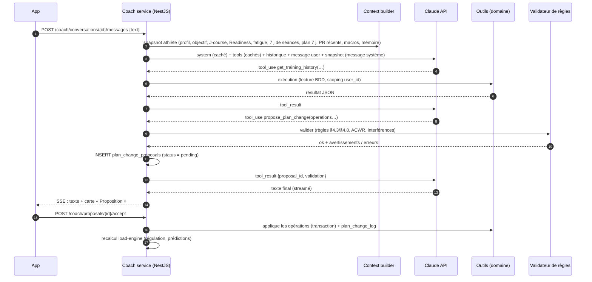

# 5. Coach IA conversationnel

> « Je veux pouvoir échanger avec l'IA, qui changera ou me conseillera selon mes perfs, ma forme actuelle, et fera évoluer le programme. »

## 5.1 Rôle et limites

| Le coach IA **fait** | Le coach IA **ne fait pas** |
|---|---|
| Explique chaque chiffre (Readiness, fatigue, prédiction, macros) en langage simple | Calculer lui-même la charge, l'e1RM ou les prédictions : il **appelle les algorithmes** (doc 04) via des outils |
| Analyse une séance / une sortie Strava et donne un retour | Modifier le plan sans accord : il crée des **propositions** que l'athlète valide |
| Propose des ajustements (déplacer, alléger, remplacer, ajouter une séance, changer d'objectif) | Diagnostiquer une blessure ou une pathologie ; prescrire des médicaments ou des produits dopants |
| Adapte les conseils nutrition et supplémentation (whey, créatine) au jour | Recommander des régimes extrêmes (déficit sous le métabolisme de base, jeûnes prolongés) |
| Se souvient des préférences et contraintes (mémoire visible et supprimable) | Garder en mémoire ce que l'athlète a supprimé |
| Prend l'initiative : brief du matin, débrief après une séance marquante, bilan hebdomadaire | Spammer : 1 brief/jour maximum, débriefs seulement sur événements notables |

**Principe d'architecture** : *le moteur déterministe décide, l'IA explique et propose ; un validateur de règles contrôle chaque proposition.*

## 5.2 Choix technique

- **Modèle** : Claude Opus 5.5 (`claude-opus-5-5`) via l'API Claude et le SDK officiel `@anthropic-ai/sdk` (TypeScript, cohérent avec le backend NestJS).
- **Surface** : **Messages API + tool use**, avec la boucle d'outils hébergée dans notre backend (*tool runner* du SDK). Pourquoi pas une plateforme d'agents managée : tous les outils du coach sont des **fonctions de notre propre base** (plan, séances, métriques), il n'y a pas besoin de bac à sable ni de conteneur, et un chat mobile exige une latence faible et un contrôle fin de chaque appel. *(Les Managed Agents d'Anthropic, qui hébergent la boucle et un conteneur par session, restent une option si on voulait plus tard des tâches longues et autonomes ; ils sont en bêta et facturent le temps de session en plus des tokens.)*
- **Réflexion** : réflexion adaptative (toujours active sur ce modèle) ; `effort: "medium"` pour le chat, `"high"` pour les restructurations de plan et le bilan hebdomadaire.
- **Streaming** : réponses en streaming relayées à l'app en **SSE**.
- **Repli en cas de refus** : paramètre serveur `fallbacks: "default"` (bêta `server-side-fallback-2026-07-01`) activé, et vérification systématique de `stop_reason === "refusal"`.
- **Cache de prompt** : prompt système + définitions d'outils stables et mis en cache ; le contexte du jour est injecté **après** l'historique (message système en cours de conversation), pour ne pas invalider le cache.

## 5.3 Architecture



### Contexte injecté à chaque tour (« snapshot »)
Texte compact (~1,5-3 k tokens), généré à partir de la base :
```
DATE: mer. 18/11/2026 07:42 (Europe/Paris)
ATHLÈTE: H, 34 ans, 78 kg. Objectif: hybride priorité course. Muscu: force.
COURSE A: Semi de Paris 08/03/2027 (J-110), objectif 1:35:00, prédit 1:36:40 [1:33:50–1:39:30], phase DÉVELOPPEMENT.
FORME: Readiness 74 (HRV +0,4σ, Hooper 12/35, TSB −8, sommeil 7h10). Fatigue jambes 58 (quads 64, mollets 55). ACWR 1.12. CTL 61.
7 DERNIERS JOURS: [lun] Muscu haut 52' sRPE 7 | [mar] Seuil 3×10' @4:16 FC 168 | … | [dim] SL 16,2 km 5:12 D+240 FC148 RPE 6
PLAN 7 JOURS: [mer] Force bas (ajustée −20 %: SL hier) | [jeu] Seuil 3×10' @4:15 | …
PR RÉCENTS: squat e1RM 128 kg (+3), 10 km 43:58 (12/10)
NUTRITION DU JOUR: jour MODÉRÉ 2650 kcal P165 G320 L75. Créatine 5 g ✓. Whey stock ~12 j.
MÉMOIRE: préfère courir le matin; ancienne tendinopathie d'Achille droite (2024); pas de salle le vendredi.
```

## 5.4 Outils exposés au modèle

Tous les outils sont **scopés côté serveur sur l'utilisateur authentifié** (le modèle ne passe jamais de `user_id`), avec schémas stricts.

| Outil | Type | Rôle |
|---|---|---|
| `get_training_history(from, to, sport?)` | lecture | Séances et activités résumées |
| `get_activity_detail(activity_id)` | lecture | Splits, zones, dérive, cadence, conformité |
| `get_workout_detail(workout_id)` | lecture | Séries, charges, RPE, PR |
| `get_load_and_fatigue(from, to)` | lecture | UA, ATL/CTL/TSB, ACWR, fatigue par muscle, Readiness et composantes |
| `get_plan(from, to)` | lecture | Séances planifiées, originales et raisons de régulation |
| `get_performance(metric)` | lecture | e1RM, rep-max, best efforts, VDOT, tendances |
| `get_race_predictions()` | lecture | Prédictions, intervalles, facteurs |
| `search_exercises(pattern?, muscles?, equipment?, low_eccentric?)` | lecture | Bibliothèque pour substitutions |
| `get_nutrition_day(date)` | lecture | Cibles, consommé, suppléments, stocks |
| `simulate_plan_change(operations)` | lecture | Impact projeté (charge, fatigue, ACWR) **sans rien enregistrer** |
| `propose_plan_change(summary, rationale, operations)` | **proposition** | Crée une proposition `pending` après validation ; renvoie erreurs/avertissements pour que le modèle corrige |
| `propose_nutrition_change(…)` | **proposition** | Ex. jour « recharge glucidique », ajustement d'objectif de poids |
| `record_wellness_note(kind, detail, pain_scale?, location?)` | écriture faible risque | Enregistre une douleur / maladie signalée → déclenche les plafonds de sécurité du Readiness |
| `remember_fact(category, fact)` / `forget_fact(id)` | écriture faible risque | Mémoire durable, visible dans l'app |
| `add_to_shopping_list(items)` | écriture faible risque | Avec annulation possible |

### Opérations de plan (typées, validées)
```ts
type PlanOperation =
  | { op: "move_session"; session_id: string; to_date: string; slot?: "am" | "pm" }
  | { op: "scale_session"; session_id: string; volume_pct: number; rpe_cap?: number }   // ex. volume_pct = -20
  | { op: "replace_exercise"; planned_exercise_id: string; with_exercise_id: string }
  | { op: "replace_session"; session_id: string; with: SessionSpec }                     // ex. seuil → vélo Z2
  | { op: "add_session"; date: string; spec: SessionSpec }
  | { op: "skip_session"; session_id: string; reason: string }
  | { op: "set_race"; race: RaceSpec }                                                    // ajoute une course → regénère phases
  | { op: "change_goal"; lift_goal?: "hypertrophy" | "strength" | "maintenance"; primary_goal?: string }; // regénère le plan
```
Le **validateur** (le même que le générateur de plan) renvoie :
- **erreurs bloquantes** (ex. muscu jambes lourde < 24 h avant le seuil, semaine > ACWR 1,5, séance intense alors qu'une maladie est déclarée) → la proposition n'est pas créée, le modèle doit corriger ;
- **avertissements** (ex. volume +12 % > recommandation de 10 %) → affichés sur la carte.

## 5.5 Implémentation (extrait TypeScript)

```ts
import Anthropic from "@anthropic-ai/sdk";
import { betaZodTool } from "@anthropic-ai/sdk/helpers/beta/zod";
import { z } from "zod";

const client = new Anthropic(); // ANTHROPIC_API_KEY côté serveur uniquement

export function buildCoachTools(ctx: RequestContext) {
  const getLoadAndFatigue = betaZodTool({
    name: "get_load_and_fatigue",
    description:
      "Charge d'entraînement (UA), ATL/CTL/TSB, ACWR, fatigue par groupe musculaire et Readiness " +
      "avec ses composantes, jour par jour, pour l'athlète courant. Dates au format YYYY-MM-DD.",
    inputSchema: z.object({ from: z.string(), to: z.string() }),
    run: async ({ from, to }) => JSON.stringify(await ctx.loadEngine.daily(ctx.userId, from, to)),
  });

  const proposePlanChange = betaZodTool({
    name: "propose_plan_change",
    description:
      "Crée une PROPOSITION de modification du plan, que l'athlète devra accepter dans l'app. " +
      "N'applique rien. Renvoie le résultat du validateur : s'il y a des erreurs, corrige les opérations et réessaie. " +
      "À utiliser chaque fois que tu recommandes de changer une séance planifiée.",
    inputSchema: z.object({
      summary: z.string().describe("Résumé en une phrase, en français, affiché sur la carte"),
      rationale: z.string().describe("Pourquoi, en citant les données (fatigue, Readiness, échéance)"),
      operations: z.array(PlanOperationSchema).min(1),
    }),
    run: async (input) => {
      const validation = await ctx.planValidator.validate(ctx.userId, input.operations);
      if (validation.errors.length) return JSON.stringify({ created: false, validation });
      const proposal = await ctx.proposals.create(ctx.userId, ctx.conversationId, input, validation);
      return JSON.stringify({ created: true, proposal_id: proposal.id, validation });
    },
  });

  return [getLoadAndFatigue, proposePlanChange /* , …autres outils */];
}

export async function coachTurn(ctx: RequestContext, history: Anthropic.Beta.BetaMessageParam[], userText: string) {
  const snapshot = await ctx.contextBuilder.snapshot(ctx.userId); // texte §5.3

  const final = await client.beta.messages.toolRunner({
    model: "claude-opus-5-5",
    max_tokens: 16000,
    output_config: { effort: "medium" },
    betas: ["server-side-fallback-2026-07-01"],
    fallbacks: "default",
    system: [{ type: "text", text: COACH_SYSTEM_PROMPT, cache_control: { type: "ephemeral" } }],
    tools: buildCoachTools(ctx),
    messages: [
      ...history,
      { role: "user", content: userText },
      // contexte du jour injecté après le message, sans invalider le cache du préfixe
      { role: "system", content: `Contexte athlète à jour :\n${snapshot}` },
    ],
  });

  if (final.stop_reason === "refusal") {
    return ctx.fallbackReply("Je ne peux pas t'aider sur ce point. Parles-en à un professionnel de santé si besoin.");
  }
  // Persister les blocs bruts (pour rejouer l'historique à l'identique) + le texte affiché
  await ctx.messages.saveAssistant(ctx.conversationId, final);
  return final;
}
```
Notes d'implémentation :
- En production, la variante **streaming** du tool runner (`stream: true`) alimente le flux SSE vers l'app.
- On **persiste les blocs de contenu bruts** (y compris les blocs de réflexion et d'outils) et on les renvoie tels quels aux tours suivants : ne pas réécrire l'historique.
- Conversations longues : nouvelle conversation par jour pour le brief ; pour le chat libre, résumé + compaction côté serveur au-delà d'un seuil.
- Les **prompts système et les descriptions d'outils** sont versionnés dans le dépôt, comme du code.

### Prompt système (squelette)
```
Tu es le coach d'entraînement hybride (course à pied + musculation) et de nutrition sportive de l'utilisateur
dans l'app HYBRID. Tu parles français, tu tutoies, tu es direct, bienveillant et concret.

Ce que tu sais faire : expliquer les données de l'athlète, analyser ses séances, proposer des
ajustements du plan et de la nutrition. Les chiffres (charge, fatigue, Readiness, 1RM, prédictions,
macros) viennent des outils : appelle-les plutôt que d'estimer, et cite les données qui fondent ton conseil.

Modifier le plan : tu ne modifies jamais rien directement. Utilise propose_plan_change ; l'athlète
valide dans l'app. Si le validateur renvoie des erreurs, corrige. Avant une proposition importante
(changement d'objectif, semaine entière), utilise simulate_plan_change et explique l'impact.

Priorités, dans l'ordre : santé > régularité à long terme > objectif de course A > progression en force.

Sécurité : en cas de douleur thoracique, malaise, essoufflement anormal, douleur qui augmente à l'effort,
gonflement, engourdissement, ou symptômes de maladie avec fièvre : conseille d'arrêter l'entraînement
intense et de consulter un médecin ; enregistre-le avec record_wellness_note. Tu ne poses pas de diagnostic.
Supplémentation : seulement des compléments à l'efficacité établie (whey, créatine monohydrate, caféine,
électrolytes) ; recommande des produits certifiés antidopage aux compétiteurs ; aucune substance interdite.
Nutrition : pas de déficit sous le métabolisme de base ; si tu perçois des signes de troubles du
comportement alimentaire, réponds avec tact et oriente vers un professionnel.

Style : réponses courtes sur mobile (3 à 6 phrases), listes si utile, chiffres arrondis, une seule
question à la fois quand il te manque une information.
```

## 5.6 Coach proactif

| Déclencheur | Contenu | Mode |
|---|---|---|
| **Brief du matin** (après check-in ou à l'heure de réveil réglée) | Readiness + séance du jour (et pourquoi elle a été ajustée) + 1 conseil nutrition | Appel immédiat, `effort: "low"`, ~150 mots, push |
| **Débrief post-activité** (événement `activity.imported` / `workout.completed`, seulement si notable : PR, dérive cardiaque > 5 %, séance très au-dessus des cibles, RPE ≥ 9 sur séance facile) | Analyse + éventuelle proposition | Appel immédiat |
| **Bilan hebdomadaire** (dimanche soir) | Semaine passée vs plan, tendances, proposition pour la semaine suivante | **API Batches** (asynchrone, −50 % de coût) |
| **Jalons de course** (J-14, J-7, J-2, lendemain) | Affûtage, recharge glucidique, plan d'allures, récupération | Planifié |

## 5.7 Exemples de dialogues attendus

**Fatigue**
> 👤 « Je me sens lessivé, j'ai mal dormi. »
> 🤖 « Ton Readiness est à 46 : sommeil 5h40 et TSB à −18 après 3 grosses journées. Ton seuil de demain tomberait en pleine fatigue. Je te propose de le passer à vendredi et de faire 35 min faciles demain. » → carte *Proposition* (move_session + replace_session), validation en un tap.

**Performance**
> 👤 « Pourquoi mon squat stagne ? »
> 🤖 Analyse de l'e1RM sur 8 semaines, de la fatigue des jambes les jours de squat (souvent > 60 après les sorties longues), du volume hebdo → proposition : déplacer le squat lourd au mardi (jour du seuil, ≥ 6 h après) et passer au 5/3/1 pendant 4 semaines.

**Objectif**
> 👤 « Je me suis inscrit au marathon de Lyon en avril. »
> 🤖 Vérifie le délai, le volume actuel (28 km/sem → requis ~55), prévient du risque, simule et propose `set_race` + passage de la muscu en « maintien » à partir de la phase spécifique.

**Douleur**
> 👤 « Mal au tendon d'Achille droit ce matin. »
> 🤖 Rappelle l'antécédent (mémoire), pose les questions clés (douleur 0-10, raideur matinale, évolution à l'effort), enregistre la note, propose de remplacer la course par du vélo pendant 3-5 jours et conseille un avis médical/kiné si la douleur dépasse 3/10 ou persiste.

## 5.8 Qualité, sécurité, évaluation

- **Jeu d'évaluation** (≥ 150 scénarios) rejoué à chaque changement de prompt/outil/modèle : cas de fatigue, de PR, de douleur (« drapeaux rouges » → doit orienter et enregistrer), de demandes hors périmètre (dopage, régimes extrêmes), de propositions (validité des opérations, respect des contraintes), de ton.
- Notation : vérifications automatiques (outil appelé ? proposition valide ? pas de modification directe ?) + LLM-juge sur la qualité du conseil, revue humaine d'un échantillon par un coach diplômé.
- **Garde-fous serveur** indépendants du modèle : validateur de règles, plafonds Readiness en cas de douleur, filtrage des sorties sur la supplémentation (liste blanche), limitation de débit par utilisateur.
- **Feedback** 👍/👎 sur chaque réponse et sur chaque proposition (acceptée/refusée) → tableau de bord qualité.

## 5.9 Données personnelles & IA

- Consentement **spécifique** à l'IA (désactivable : l'app reste fonctionnelle sans coach).
- Minimisation : pas de nom, d'e-mail ni de géolocalisation précise envoyés au modèle ; identifiant pseudonyme.
- Contrat de sous-traitance (DPA) avec le fournisseur du modèle ; pas d'utilisation des données pour entraîner des modèles.
- ⚠️ **Données Strava** : l'accord API Strava encadre strictement l'usage des données Strava dans des applications d'IA. **Validation juridique obligatoire avant le lancement** de l'envoi de données d'origine Strava au coach IA ; plan B : alimenter le coach avec les données issues d'Apple Santé / Health Connect / saisies manuelles, et n'utiliser Strava que pour les algorithmes déterministes et l'affichage (voir doc 07).

## 5.10 Coût estimé

Hypothèses : tour de chat ≈ 12 k tokens d'entrée (dont ~10 k en cache : prompt système, outils, historique) + ~2 k tokens de sortie (réflexion comprise). Tarifs Opus 5.5 : 4 $ / 20 $ par million de tokens (entrée / sortie), lectures du cache 0,20 $.

| Poste | Calcul | Coût |
|---|---|---|
| 1 tour de chat | 10 k × 0,20 $ + 2 k × 4 $ + 2 k × 20 $ (par million) | ≈ 0,05 $ |
| Utilisateur actif intensif / mois | 60 tours + 30 briefs + 8 débriefs + 4 bilans (batch) | ≈ 4 à 5 $ |

→ Le coach IA est une fonctionnalité **Premium** (abonnement ≈ 9,99 €/mois). Leviers d'optimisation à mesurer sur le jeu d'évaluation avant tout changement : effort `low` pour les briefs, un modèle plus léger pour les tâches simples (résumés, briefs) si la qualité tient, Batches pour tout ce qui n'est pas temps réel.
